# Documentación de la Base de Datos y Diagrama Entidad-Relación (DER)

## Modelo de Datos

La base de datos relacional (PostgreSQL) está estructurada para garantizar integridad referencial, alta velocidad de consulta por casillero (000-999) y escalabilidad sin costo de infraestructura.

```mermaid
erDiagram
    USERS ||--o{ ALBUMS : "owns"
    USERS ||--o{ ALBUM_MEMBERS : "belongs to"
    ALBUMS ||--o{ ALBUM_MEMBERS : "contains members"
    ALBUMS ||--o{ STICKERS : "contains stickers"
    USERS ||--o{ STICKERS : "captured by"
    USERS ||--o{ ALBUM_INVITES : "creates"
    ALBUMS ||--o{ ALBUM_INVITES : "invites to"
    ALBUMS ||--o{ STICKER_ACTIVITIES : "logs"
    USERS ||--o{ STICKER_ACTIVITIES : "performed by (nullable)"
    USERS ||--o{ NOTIFICATIONS : "receives"
    ALBUMS ||--o{ NOTIFICATIONS : "emits"
    USERS ||--o{ NOTIFICATIONS : "triggered by (nullable)"

    USERS {
        uuid id PK "Identificador único del usuario"
        string email UK "Correo electrónico (OAuth / local)"
        string name "Nombre o apodo del usuario"
        string avatar_url "URL de avatar"
        string auth_provider "google (histórico: facebook / github / local)"
        boolean notify_on_album_activity "Avisos de actividad #34 (default true)"
        boolean is_admin "Rol de administración #41 (default false)"
        enum status "ACTIVE | RESTRICTED #41 (default ACTIVE)"
        datetime last_login_at "Último login exitoso #41"
        datetime created_at "Fecha de registro"
        datetime updated_at "Última actualización"
    }

    ALBUMS {
        uuid id PK "Identificador único del álbum"
        string title "Nombre del álbum (ej: Álbum de Ana)"
        uuid owner_id FK "Usuario propietario del álbum"
        datetime created_at "Fecha de creación"
    }

    ALBUM_MEMBERS {
        uuid id PK "Identificador único de la membresía"
        uuid album_id FK "Álbum al que pertenece"
        uuid user_id FK "Usuario asociado"
        enum role "OWNER | ASSOCIATE (default ASSOCIATE)"
        datetime joined_at "Fecha de incorporación"
    }

    ALBUM_INVITES {
        uuid id PK "Identificador de la invitación #12"
        string token UK "Token único del link (1 solo uso)"
        uuid album_id FK "Álbum al que da acceso"
        uuid created_by_id FK "Usuario que generó el link"
        uuid used_by_id FK "Usuario que aceptó (null si sin uso)"
        datetime expires_at "Vencimiento (7 días)"
        datetime used_at "Fecha de aceptación (null si pendiente)"
        datetime created_at "Fecha de creación"
    }

    STICKERS {
        uuid id PK "Identificador único de la figurita"
        uuid album_id FK "Álbum en el que está pegada"
        int slot_number "Casillero asignado (0 a 999)"
        string raw_plate "Patente original detectada (ej: AB 123 CD)"
        string image_url "URL de la fotografía capturada"
        string thumbnail_url "Miniatura WebP 320px #11"
        uuid uploaded_by_user_id FK "Usuario que tomó la foto"
        datetime captured_at "Fecha y hora de captura"
    }

    STICKER_ACTIVITIES {
        uuid id PK "Entrada del log histórico #33"
        uuid album_id FK "Álbum donde ocurrió"
        uuid user_id FK "Usuario (null si fue eliminado)"
        string user_name "Snapshot del nombre (sobrevive al borrado)"
        int slot_number "Casillero afectado"
        string raw_plate "Patente de la figurita"
        enum action "PASTE | UNPASTE"
        datetime created_at "Fecha del movimiento"
    }

    NOTIFICATIONS {
        uuid id PK "Aviso para un usuario #34"
        uuid user_id FK "Destinatario"
        uuid album_id FK "Álbum de origen"
        uuid actor_user_id FK "Usuario que disparó el aviso (nullable)"
        string actor_name "Snapshot del nombre del actor"
        enum type "STICKER_PASTED | ASSOCIATE_JOINED | ASSOCIATE_LEFT | ACCESS_REVOKED"
        int slot_number "Casillero (si aplica)"
        string raw_plate "Patente (si aplica)"
        string message "Texto del aviso"
        datetime read_at "Fecha de lectura (null = sin leer)"
        datetime created_at "Fecha de creación"
    }

    EXTERNAL_API_CALLS {
        uuid id PK "Registro de llamada a API externa #48"
        string provider "plate_recognizer (default)"
        boolean ok "true si la llamada fue exitosa"
        datetime created_at "Fecha/hora de la llamada"
    }
```

## Enums

| Enum | Valores | Uso |
|---|---|---|
| `Role` | `OWNER`, `ASSOCIATE` | Rol de una membresía en `album_members`. |
| `StickerAction` | `PASTE`, `UNPASTE` | Acción registrada en el log histórico `sticker_activities` (#33). |
| `NotificationType` | `STICKER_PASTED`, `ASSOCIATE_JOINED`, `ASSOCIATE_LEFT`, `ACCESS_REVOKED` | Tipo de aviso en `notifications` (#34 / #37). |
| `UserStatus` | `ACTIVE`, `RESTRICTED` | Estado de la cuenta: `RESTRICTED` impide login y rutas autenticadas (#41). |

## Índices y Restricciones de Dominio

- **`stickers` unicidad `(album_id, slot_number)`**: evita duplicar figuritas en un mismo casillero del mismo álbum (la API responde `409`).
- **`slot_number`**: entero indexado validado entre `0` y `999`.
- **`album_members` unicidad `(album_id, user_id)`**: evita invitaciones/membresías duplicadas.
- **`users.email` único**: identidad única OAuth/correo.
- **`album_invites.token` único**: link de un solo uso (#12); índice en `albumId` para búsquedas por álbum.
- **Índices de consulta**: `sticker_activities(album_id, created_at)` (paginado del log #33), `notifications(user_id, created_at)` y `notifications(album_id)` (campana #34), `external_api_calls(provider, created_at)` (consumo mensual #48).

## Reglas de borrado (onDelete)

Definidas en [`backend/prisma/schema.prisma`](../backend/prisma/schema.prisma); son las que habilitan la **autoeliminación de cuenta (#54)** y la baja administrativa:

| Relación | Regla | Efecto |
|---|---|---|
| `albums.owner_id → users` | `Cascade` | Al borrar un usuario desaparece su álbum y, en cascada, sus figuritas, miembros e invitaciones (los asociados pierden el acceso). |
| `album_members.user_id` / `album_id` | `Cascade` | La membresía muere tanto si se borra el usuario como si se borra el álbum. |
| `stickers.uploaded_by_user_id` | `Cascade` | Las figuritas que subió el usuario se eliminan del álbum donde estén. |
| `stickers.album_id`, `notifications.album_id`, `sticker_activities.album_id` | `Cascade` | Datos dependientes del álbum. |
| `notifications.user_id` (destinatario) | `Cascade` | Los avisos del usuario se borran con su cuenta. |
| `album_invites.created_by_id` | `Cascade` | Las invitaciones que creó el usuario se revocan al eliminarse. |
| `album_invites.used_by_id` | `SetNull` | El histórico de invitaciones conserva el registro aunque el aceptador ya no exista. |
| `sticker_activities.user_id` | `SetNull` | El log sobrevive: conserva `user_name` como snapshot (#33). |
| `notifications.actor_user_id` | `SetNull` | El aviso conserva `actor_name` aunque el actor se elimine. |

> Las imágenes asociadas a las figuritas no viven en la BD: se borran del disco/Cloudinary en la baja mediante `deleteAccountCascade()` (best effort).
